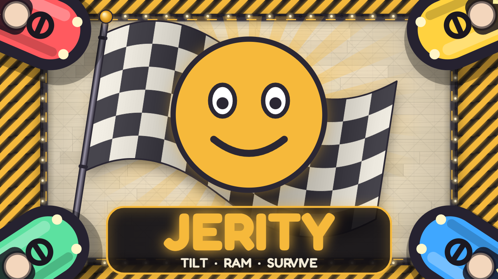

# Jerity

A bumper-car brawl for 4 to 8 players. The arena runs on a laptop or TV, everyone drives from their phone, and Jerity, an AI host, listens to the players and changes the round while it plays. Built at HackPSU Fall 2026.

## How to play

1. Open the game on a big screen and create a room. Everyone scans the QR code to join on their phone.
2. Hold your phone sideways and tilt it the way you want to drive, like rolling a marble: the further you tilt, the faster you go.
3. Ram the other cars. Damage depends on speed and angle: rear hits hurt more than side hits, and a head-on crash stuns both cars. Swing hard against your direction at speed and you tip over; tap 8 times to get back up. Walls and pillars cost you speed and a little HP.
4. Knocking someone out heals you 30% and gives you a short boost. The last car driving wins the round; if the 2-minute clock runs out, the healthiest car wins.
5. A match is 5 rounds. The final leaderboard ranks everyone by performance score: damage dealt, knockouts, round wins and time survived.

Players who turn on their mic can talk to Jerity. During each round Jerity invites everyone to speak, hears what they say and hands down a ruling on the live round: a speed boost, a freeze, a heal, reversed controls, a shield, a position swap or, very rarely, an execution. The more rulings Jerity makes, the wilder they get. Jerity also starts out cheerful and slowly gets corrupted, and the arena decays with it.

## How it's built

- **Game server** (Node 20, Express, Socket.IO): authoritative. Each room runs its own Planck.js physics world at 30 ticks per second and streams snapshots to every screen. Phones only send their tilt and taps.
- **Client** (Vite, Canvas 2D): draws the arena 100 ms behind the server and interpolates between snapshots. Every sound effect is synthesized live with the Web Audio API.
- **Jerity**: Groq transcribes the players, Gemini picks the ruling, and Fish Audio gives Jerity a voice. See [JERITY.md](JERITY.md).
- **Hosting**: the client on Vercel, the game server on Render.

## Run it locally

```bash
npm install
npm run build
npm start
```

Then open http://localhost:3000. For development, run `npm run dev` and `npm run dev:client` together. Phones need HTTPS for motion sensors and the microphone, so test on a phone with `npm run dev:phone`. Jerity's voice features need `GROQ_API_KEY`, `GEMINI_API_KEY`, `FISH_AUDIO_API_KEY` and `FISH_AUDIO_VOICE_ID` in `.env`.

`npm run sim` plays a headless round and checks the physics against the design numbers; `npm run test:jerity` checks the Jerity pipeline.

## Environment

Create a `.env` file in the repo root. These keys stay on the server and never reach the browser. The game runs without them; only Jerity needs them.

```env
GROQ_API_KEY=...
GEMINI_API_KEY=...
FISH_AUDIO_API_KEY=...
FISH_AUDIO_VOICE_ID=...
# optional
FISH_AUDIO_MODEL=s2.1-pro-free
PORT=3000
```

## Scripts

| Command | What it does |
| --- | --- |
| `npm start` | Runs the game server (also serves `client/dist`) |
| `npm run dev` | Server with auto-restart |
| `npm run dev:test` | Server plus an always-on test room with bots |
| `npm run dev:client` | Vite dev server for the client |
| `npm run dev:phone` | Vite dev server over HTTPS for phone testing |
| `npm run build` | Builds the client to `client/dist` |
| `npm run sim` | Headless physics simulation |
| `npm run fake` / `npm run fake:client` | Fake server and client for UI work |
| `npm run test:jerity` | Offline tests for the Jerity pipeline |

On desktop you can drive with the keyboard: arrows or WASD to steer and drive, Space to tap. There's also an optional Chrome smoke test with a fake microphone: `node test/jerity-browser.mjs` (set `CHROME_PATH` if Chrome isn't in its default location).

## How a Jerity exchange works

1. After the countdown, Jerity plays a short "I'm listening" clip.
2. The server opens one shared six-second listening window. Players who turned on their mic record a clip, which is uploaded over Socket.IO.
3. The server transcribes all clips together with Groq Whisper.
4. Gemini gets the transcripts, the player states and Jerity's current mood, and returns up to three actions, each with a "before" and "after" voice line.
5. For each action, Jerity plays the before line, the effect is applied, then the after line plays.
6. Jerity waits 6 to 9 seconds and the cycle repeats.

Every stage has a deadline, and the server clamps every AI-chosen value (durations 8 to 16 s, damage 50 to 100 HP, heals 100 to 200 HP). Targets are checked again when an effect applies, and results that arrive after the round ends are dropped.

## Project structure

```
client/          Browser client (Vite)
  src/screens/   home, lobby, game, results, spectate
  src/input.js   Tilt controls and calibration
  src/render.js  Canvas renderer
  src/interp.js  Snapshot interpolation
  public/audio/  Pre-recorded Jerity clips (see its README)
server/          Game server
  index.js       Express + Socket.IO entry point
  rooms.js       Lobbies, rounds and matches
  game.js        One round: physics, damage, effects, snapshots
  mechanics.js   Pure damage and scoring rules
  sim.js         Headless simulation
  bots.js        Bot drivers for the test room
shared/          Config, constants and protocol used by both sides
verity/          Jerity AI pipeline (STT, Gemini, TTS)
test/            Jerity tests
```

## Deployment

The client and server deploy separately, so deploy `main` to both.

- **Vercel** builds the client (`vercel.json`). Set `VITE_SERVER_URL` to the Render server's URL at build time.
- **Render** runs the game server from `render.yaml` (`npm start`). Add `GROQ_API_KEY`, `GEMINI_API_KEY`, `FISH_AUDIO_API_KEY` and `FISH_AUDIO_VOICE_ID` as secrets in the Render dashboard. Keep it at one instance, since rooms live in memory.

After deploying, `/health` on the server should report `jerity.configured: true`.
